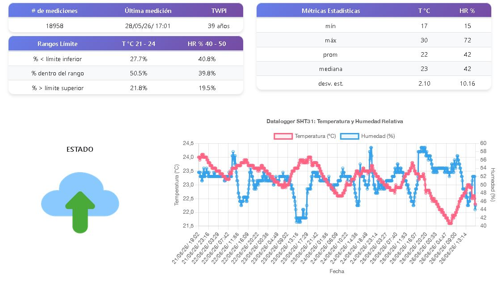

# Datalogger wifi + servidor web

Este proyecto propone un datalogger con conectividad Wi-Fi para medir temperatura y humedad relativa y un servidor web para almacenar y publicar la informacion en línea, lo que en conjunto ofrece una solucion completa y autónoma para la medicion, almacenamiento y visualización de datos espcializados.

- grafica temporal de temperatura y humedad;
- tabla de resumen con minimos, maximos, promedio, mediana y desviacion estandar;
- porcentaje de tiempo dentro y fuera de rangos definidos;
- estado del sistema segun la fecha de la ultima medicion;
- calculo de TWPI para evaluar condiciones de conservacion.

[Capture.JPG](Capture.JPG)

# Indice 👉

- [Descripcion general](#descripcion-general-)
- [Componentes](#componentes-)
- [Fabricación](#fabricacion-)
- [Librerias](#librerias-)
- [Programación](#programacion-)

# Descripcion general 🌡️

Este sistema de monitoreo ambeintal esta formado por dos partes. La primera es el dispositivo de medicion, donde el microcontrolador ESP32 mide la temperatura y humedad relativa desde el sensor SHT31 concectado por medio del bus I2C, y la envía al servidor, que recibe esos datos por HTTP, los guarda en una base de datos sql y simultaneamente actualiza un archivo JSON para su consulta posterior.

En mi caso el backend está alojado en una [Raspberry Pi 2B](https://www.raspberrypi.com/products/raspberry-pi-2-model-b/) pero puede ser algún otro equipocon soporte para PHP y base de datos MySQL, cinluyendo un servidor virtual privado. Despues, la visualizacion se realiza en el mismo u otro servidor mediante una página web estática[dataloggers.md](dataloggers.md), que toma la informacion del archivo [datos.json](datos.json) y la analiza para mostrar datos estadísticos en formato de tabla y en una grafica interactiva generada pdinámicamente.

El flujo de datos es el siguiente:

1. El ESP32 inicia el sensor SHT31 y se conecta a la red Wi-Fi.
2. Cada cierto intervalo toma una lectura de temperatura y humedad.
3. El microcontrolador envia los datos al script [insertar_datos.php](insertar_datos.php) usando HTTP GET.
4. El servidor registra la medicion y actualiza [datos.json](datos.json).
5. La pagina web consulta ese archivo para mostrar el historico, las estadisticas y el estado del sistema, usando la librería chartJS.

Con esta arquitectura se separan adquisicion, almacenamiento y visualizacion, lo que facilita el mantenimiento del proyecto y permite adaptarlo a diferentes espacios de monitoreo.

# Componentes ✔️

Los componentes principales de este sistema son los siguientes:

Datalogger

- Microcontrolador [ESP32](https://www.espressif.com/en/products/socs/esp32) como unidad de control y comunicacion Wi-Fi.
- [Sensor SHT31](https://www.mouser.mx/ProductDetail/Adafruit/2857?qs=ivJcBTDythUTq%252BPyc8dfFQ%3D%3D) para medir temperatura y humedad.
- Cargador y cable micro USB para la alimentacion de 5 voltios y 1 amper.
- Red Wi-Fi local para el envio de datos.

Servidor web

- [Raspberry Pi 2B](https://www.raspberrypi.com/products/raspberry-pi-2-model-b/) u otro equipo similar para alojar el backend y la pagina de desplpiegue.

# Fabricacion 🛠️

El ensamblaje es sumament sencillo, unicamente se conecta el microcontrolador al sensor SHT31 mediante I2C y se alimenta por micro USB. Como en cualquier equipo de monitoreo ambiental, conviene colocar el sensor en una zona con buena circulacion de aire y proteger la electronica del polvo, golpes o humedad excesiva.

Es muy conveniente fijar el sensor y el microcontrolador dentro de una carcasa o contenedor plastico ventilado.

Antes de poner el equipo en servicio se recomienda:

1. Verificar la direccion I2C del SHT31 y confirmar que responde correctamente.
2. Confirmar que el ESP32 se conecta a la red Wi-Fi del lugar de instalacion.
3. Probar desde un navegador la URL del script PHP [insertar_datos.php](insertar_datos.php).
4. Validar que el servidor escribe correctamente en la base de datos y actualiza el archivo [datos.json](datos.json).

# Librerias 📖

El programa del ESP32 utiliza varias librerias incluidas en el entorno de Arduino y otras especificas para el sensor:

- `WiFi.h` para la conexion a la red inalambrica.
- `HTTPClient.h` para realizar la peticion HTTP al servidor.
- `Wire.h` para la comunicacion I2C.
- `Adafruit_SHT31.h` para inicializar y leer el sensor.

Si necesitas apoyo con la instalacion del entorno puedes usar el [Arduino IDE](https://www.arduino.cc/en/software). En este repositorio tambien se incluyen varias dependencias dentro de la carpeta [librerias](../librerias/) y controladores USB dentro de [controlador](../controlador/), lo que facilita replicar el proyecto en otra computadora.

# Programacion 🖥️

La logica principal del sistema se encuentra en [ESP32_PHP_SHT31_HTTP_public.ino](ESP32_PHP_SHT31_HTTP_public.ino). Antes de cargar el sketch al ESP32 es necesario editar tres grupos de parametros:

- credenciales de la red Wi-Fi (`ssid` y `password`);
- direccion del servidor en la variable `serverName`;
- intervalo de envio definido en `interval`.

Durante la ejecucion, el sketch inicializa el puerto serial, arranca el sensor SHT31 y espera conexion Wi-Fi. Despues, dentro de `loop()`, controla el tiempo transcurrido y llama a `enviarDatos()` cuando corresponde. Esa funcion toma las lecturas, construye la URL con los parametros de temperatura y humedad y la envia al servidor.

En el backend, [insertar_datos.php](insertar_datos.php) debe configurarse con los datos reales de conexion a la base de datos. Ese script recibe `temperatura` y `humedad`, inserta el registro y genera la informacion que luego queda disponible en [datos.json](datos.json).

Finalmente, [dataloggers.md](dataloggers.md) se encarga de presentar la informacion con graficas, tablas resumen y el estado del sistema a partir del ultimo registro disponible.
