# 🚀 Guía paso a paso para usar tu placa TTGO T‑Display v1 con el software Arduino IDE

---

# GUIA PARA WINDOWS

## 🖥️ Paso 1: Identificar la versión de tu sistema operativo

Este paso es **para determinar qué versión de Arduino IDE necesitas instalar**.

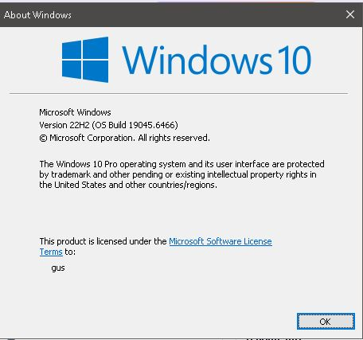

- **Windows**:
  - Presiona `Win + R`, escribe `winver` y confirma la versión.
  - Si es **Windows 10/11**, instala **Arduino IDE moderno (2.x)**.
  - Si es **Windows 7/8**, instala **Arduino IDE Legacy (1.8.x)**.

---

## 📥 Paso 2: Descargar e instalar Arduino IDE

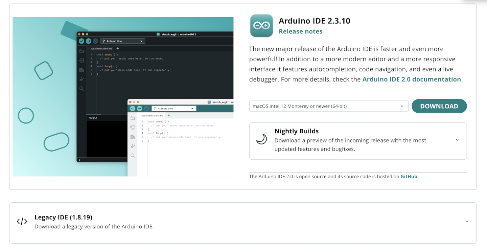

1. Visita la página oficial: [Arduino IDE Download](https://www.arduino.cc/en/software/)
2. Descarga la versión adecuada según tu sistema operativo (moderno o legacy).
3. Ejecuta el archivo `.exe` y sigue el asistente.

---

## 🔗 Paso 3: Conectar el microcontrolador y verificar el puerto COM


1. Presiona la tecla Windows y escribe Device Manager, ubica la sección de Puertos COM & LPT
2. Verifica que ahí el sistema muestre una entrada con el número COM cuando conectas la placa ESP32 TTGO T‑Display.
3. Asegurate de usar un **cable USB‑C de datos**.
4. Si no aparece la placa TTGO T‑Display es porque necesita un **driver USB–Serial** para que la computadora la reconozca ve al paso 4, de otra manera ve al 5.

---

## 🔌 Paso 4: Instalar drivers para la placa TTGO T‑Display V1

La TTGO T‑Display necesita un **driver USB–Serial** para que la computadora la reconozca.

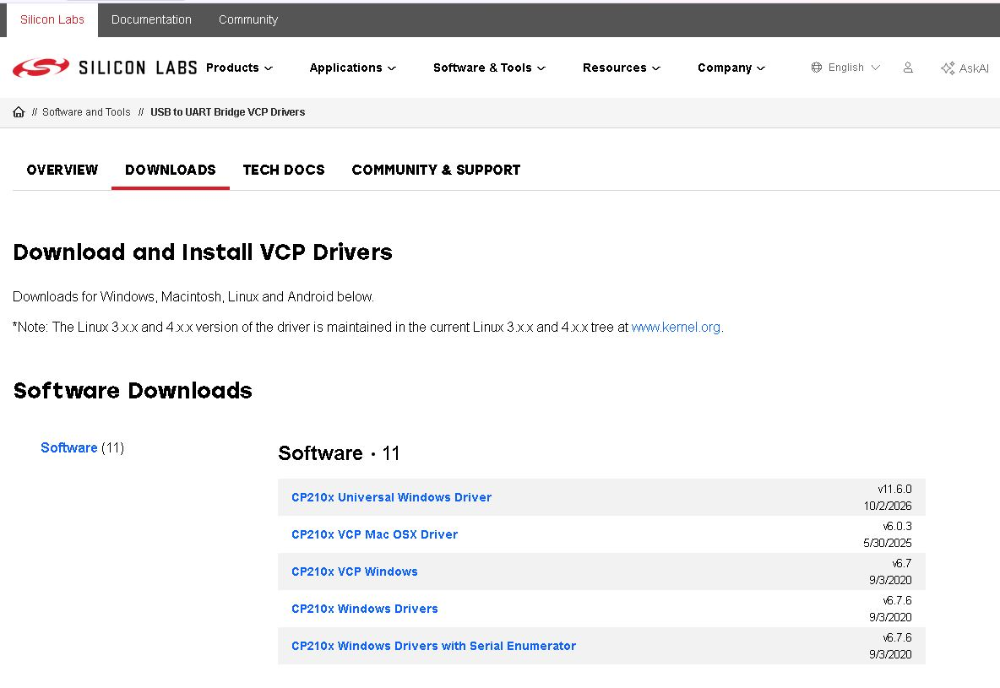

1. **Descarga Driver**
   - Selecciona la opción que dice CP210x VCP Windows [CP210x VCP Drivers – Silicon Labs](https://www.silabs.com/developer-tools/usb-to-uart-bridge-vcp-drivers)

2. **Instala el Driver**
   - Descomprime la carpeta y ejecuta el archivo .exe que corresponda a tu sistema operativo, sigue las indicaciones de instalacón.

3. **Reinicia tu computadora** para que el sistema reconozca la placa.

---

## ⚙️ Paso 5: Instalar gestor de tarjetas ESP32

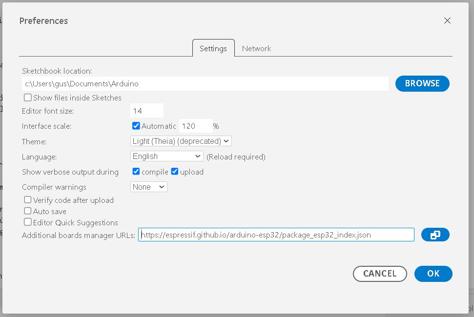

1. Abre el progrma Arduino IDE y ve al menú → _Archivo → Preferencias_.
2. En “Additional Boards Manager URLs” pega la URL oficial actual:
   ```
   https://espressif.github.io/arduino-esp32/package_esp32_index.json
   ```
3. Haz clic en **OK**.
   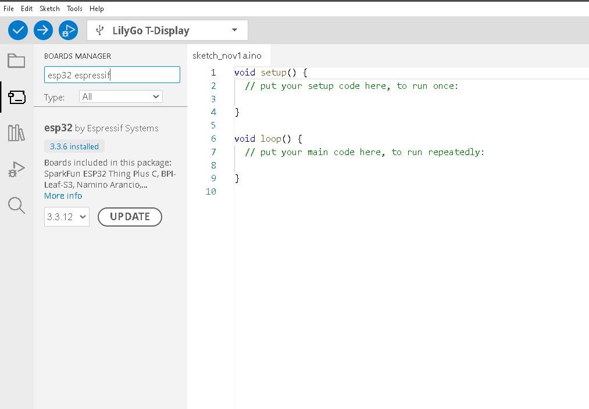
4. Ve a _Herramientas → Placa → Gestor de tarjetas_.
5. Busca **ESP32 by Espressif Systems** y da clic en **Instalar**.

---

## 📚 Paso 6: Instalar librerías necesarias

En _Programa → Incluir librería → Administrar librerías_ busca e instala:

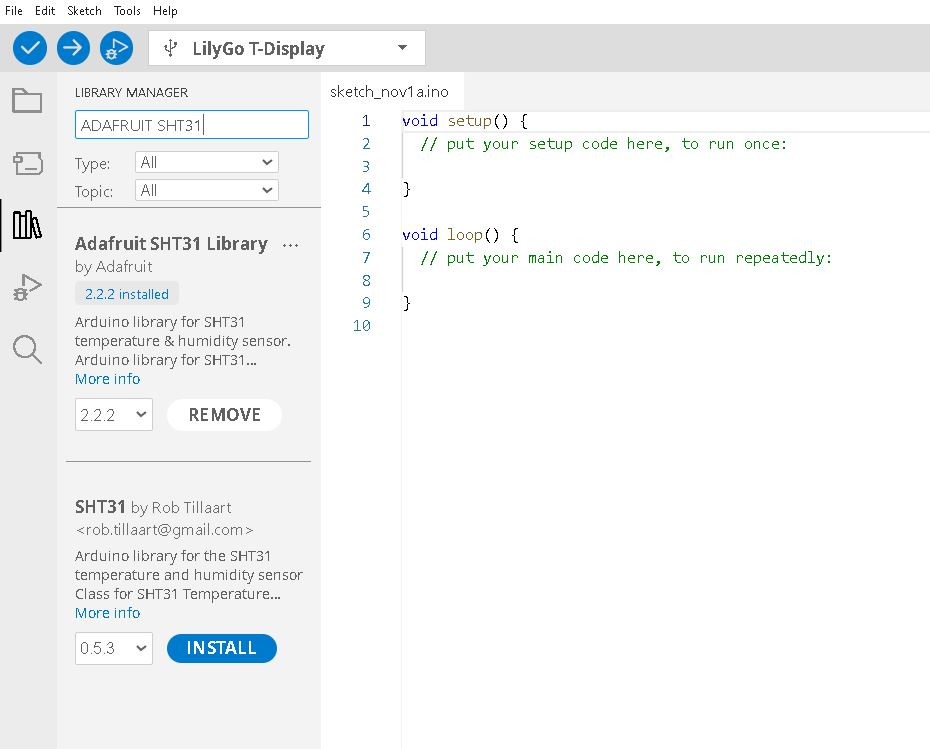

- **Adafruit SHT31**

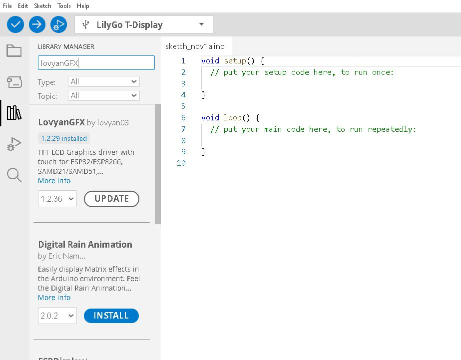

- **LovyanGFX**

---

## 💡 Paso 7: Seleccionar placa y puerto y Subir un codigo de prueba

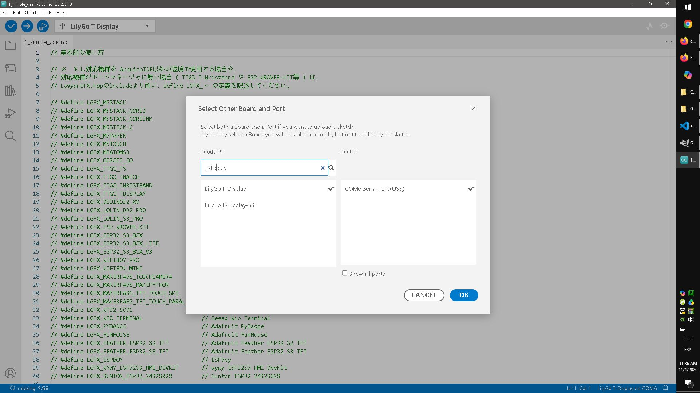

1. En el Arduino IDE.

2. Ve al Menú Archivo y abre el archivo ubicado en → Ejemplos → LovyanGFX → HowToUse 1_simple_use.

3. En el menu desplegable ubicado a la derecha de los botones verdes ve a la opción para selecciona la placa y el puerto, elige la placa: ESP32 TTGO T‑Display.

4. Selecciona el puerto correcto que identificaste en el paso 3.

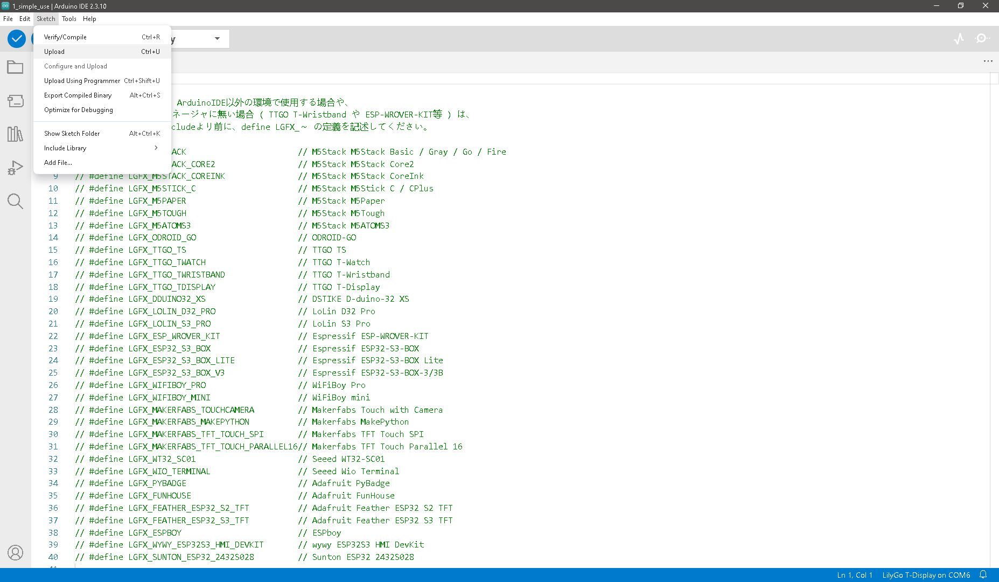

5. Haz clic en Subir y espera a que terminen porque puede tardar varios minutos.

La pantalla mostrará texto y gráficos básicos, confirmando que la librería funciona y que la placa está configurada correctamente. 🎉

---

# GUIA PARA MACOS

## 🖥️ Paso 1: Identificar la versión de tu sistema operativo

Este paso es **para determinar qué versión de Arduino IDE necesitas instalar**.

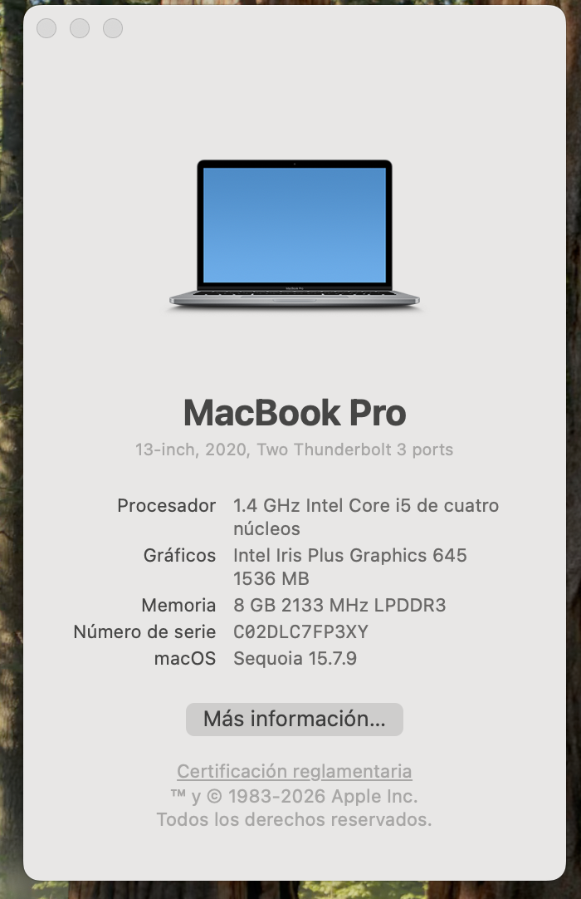

- Haz clic en Command ⌘ → _Acerca de este Mac_ → revisa la versión.
- Si es **10.15 Catalina o más nuevo**, instala **Arduino IDE moderno (2.x)**.
- Si es **10.14 Mojave o anterior**, instala **Arduino IDE Legacy (1.8.x)**.

---

## 📥 Paso 2: Descargar e instalar Arduino IDE


1. Abre la página oficial: [Arduino IDE Download](https://www.arduino.cc/en/software/)
2. Descarga la versión adecuada según tu sistema operativo (moderno o legacy).
3. Abre el archivo `.dmg` y arrastra Arduino IDE a _Aplicaciones_.

---

## ⚙️ Paso 3: Instalar gestor de tarjetas ESP32

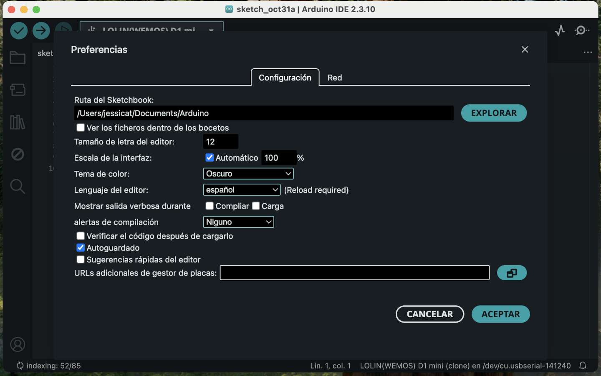

1. Abre el programa Arduino IDE y ve al menú → _Archivo → Preferencias_.
2. En “Additional Boards Manager URLs” pega la URL oficial actual:
   ```
   https://espressif.github.io/arduino-esp32/package_esp32_index.json
   ```
3. Haz clic en **OK**.

   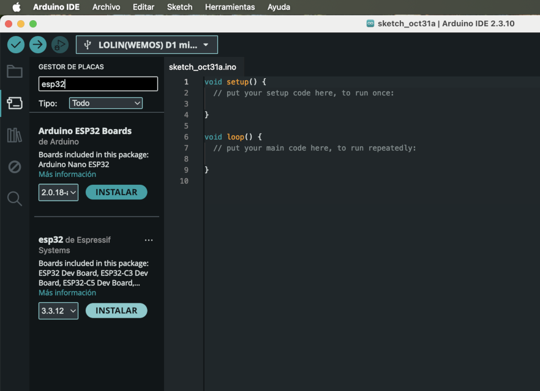

4. Ve al menú _Herramientas → Placa → Gestor de tarjetas_.
5. Busca **ESP32 by Espressif Systems** → clic en **Instalar**.

---

## 🔗 Paso 4: Conectar el microcontrolador y verificar el puerto

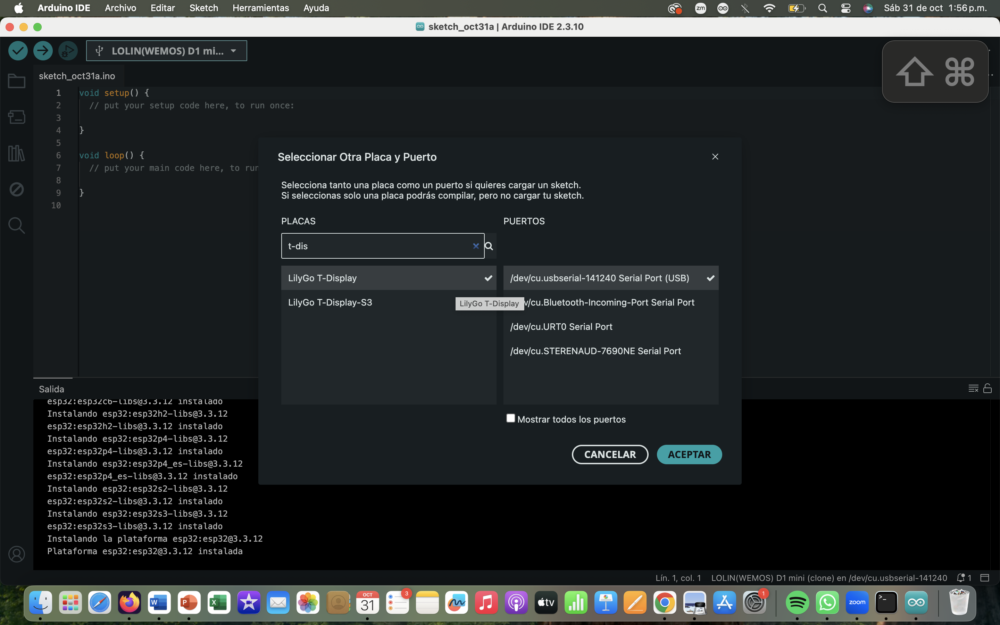

1. Usa un **cable USB‑C de datos**.
2. Conecta la placa ESP32 TTGO T‑Display.
3. En el Arduino IDE abre el menu desplegable ubicado a la derecha de los botones verdes y selecciona la opción para seleccionar la placa y el puerto, en puerto deveras ver algo como `/dev/cu.usbserial-...` o `/dev/cu.wchusbserial-...`.
4. Si no aparece nada es porque la placa TTGO T‑Display es porque necesita un **driver USB–Serial** para que la computadora la reconozca ve al paso 5, de otra manera ve al 6.

---

## 🔌 Paso 5: Instalar drivers serial para la placa TTGO T‑Display V1


1. Abre la paágina de descarga de los [CP210x VCP Drivers – Silicon Labs](https://www.silabs.com/developer-tools/usb-to-uart-bridge-vcp-drivers)

2. **Descarga el driver** - Selecciona la opción que dice CP210x VCP MAC OSX Driver

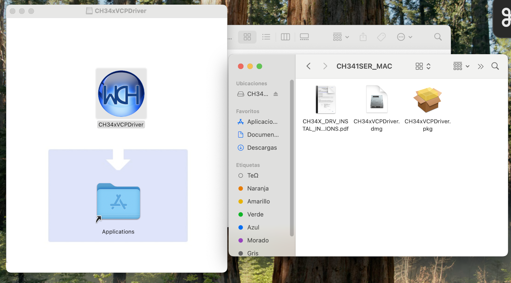

3. **Instala y reinicia tu computadora** para que el sistema reconozca la placa.
4. Vuelve al paso 4 y verifica el puerto.

---

## 📚 Paso 6: Instalar librerías necesarias

Abre el Arduino IDE y ve al menú _Programa → Incluir librería → Administrar librerías_ ahí busca e instala:

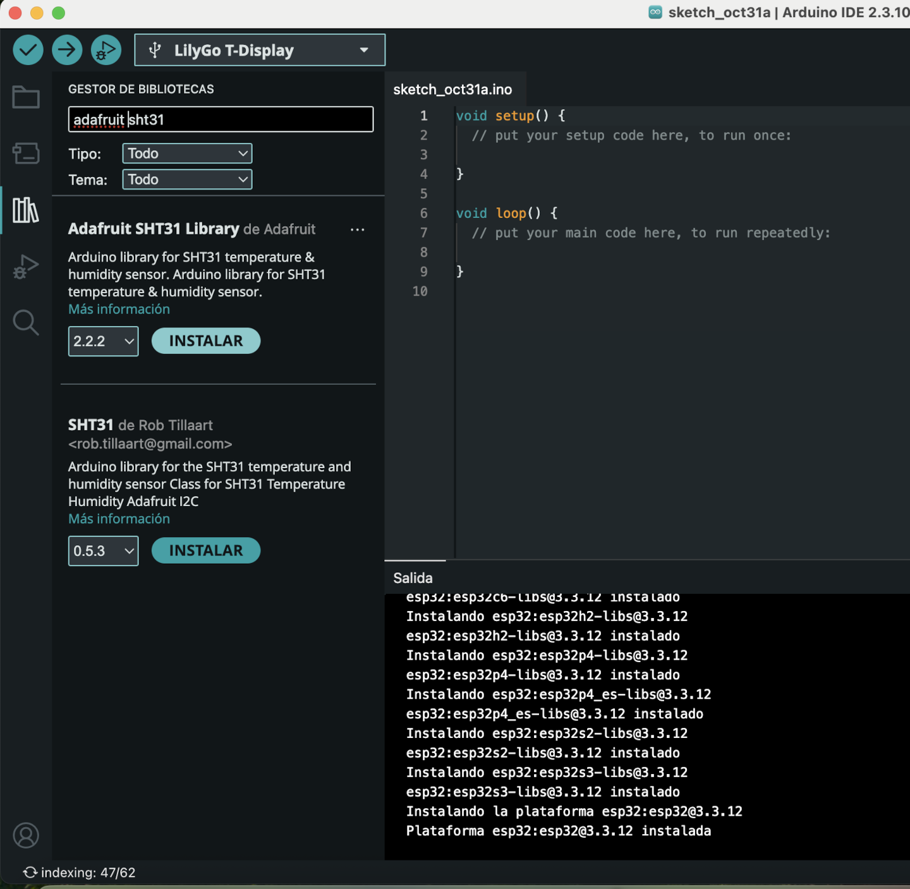

- **Adafruit SHT31**

  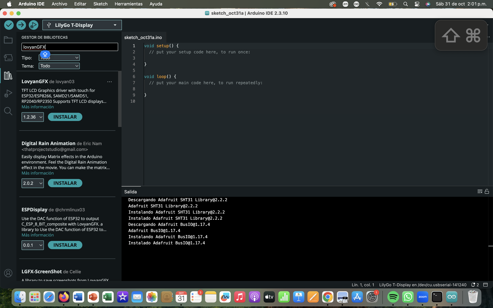

- **LovyanGFX**

---

## 💡 Paso 7: Subir un codigo de prueba

1. Abre el codigo ubicado en el menú Archivo → Ejemplos → LovyanGFX → HowToUse 1_simple_use.


3. Selecciona la placa: ESP32 TTGO T‑Display.

4. Selecciona el puerto correcto que identificaste en el paso 4.

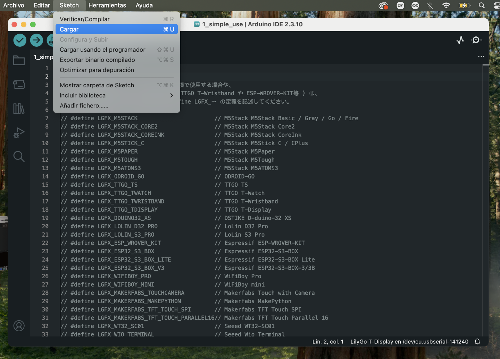

5. Haz clic en Subir y espera a que terminen porque puede tardar varios minutos.

Si todo sale bien la pantalla de la placa mostrará texto y gráficos básicos, confirmando que la librería funciona y que la placa está configurada correctamente. 🎉

## ⚠️ Detalles importantes

- Usa siempre un **cable USB‑C de datos**.
- Si el IDE moderno (2.x) es muy lento en tu PC, instala el **IDE Legacy (1.8.x)**.
- En macOS recientes, puede que tengas que dar permisos de seguridad para el driver.
- Si la placa no aparece en puertos, reinstala el driver y reinicia.
