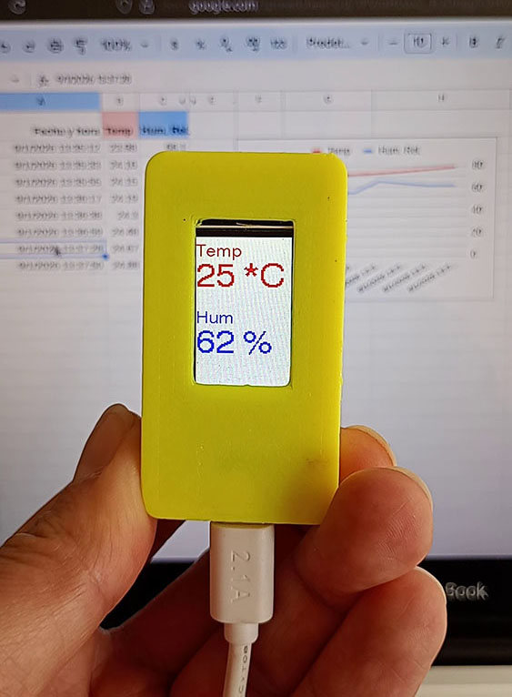
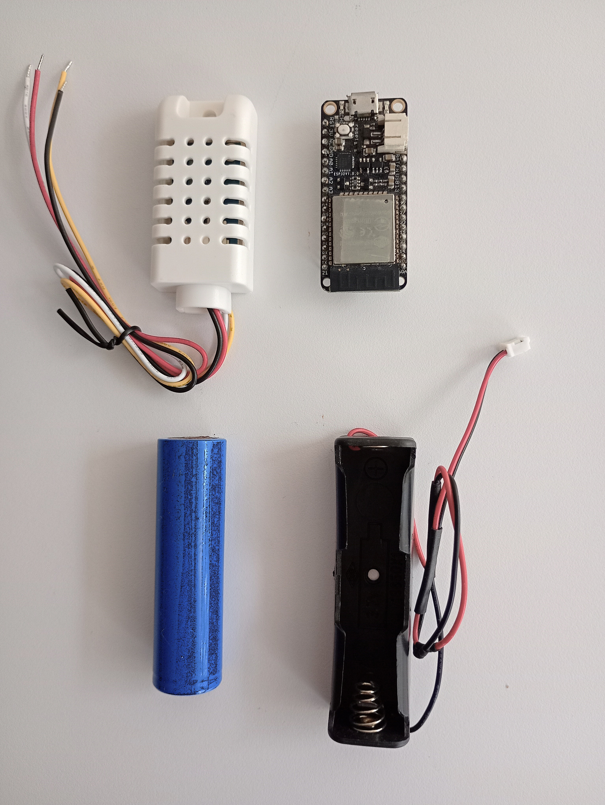
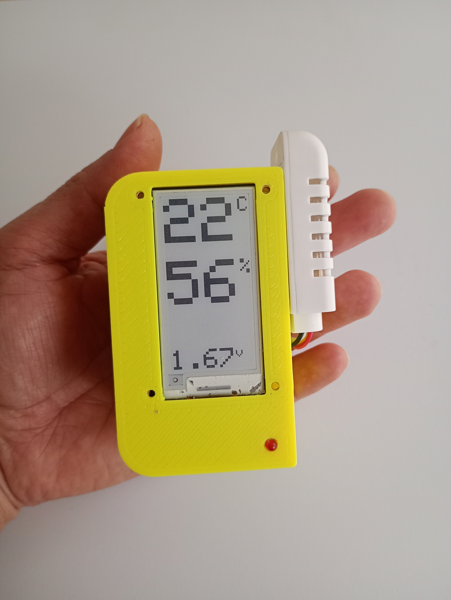

# Dataloggers Abierto para Conservación Preventiva

---

Este repositorio ofrece diversos ejemplos de cómo construir dataloggers ambientales para el monitoreo de agentes de deterioro como la temperatura, la humedad relativa y la radiación visible e ultravioleta que sean utiles en la conservación del patrimonio cultural. La motivacion para hacer nuestro propio datalogger para conservación puede ser económica, ambiental, política o simplemente de curiosidad y aprendizaje.

## Objetivo general

Su objetivo es invitar aotras personas a experimentar y compartir distintas arquitecturas de adquisición, almacenamiento y análisis de datos ambientales desde microcontroladores.

En lugar de limitarse a un sólo microcontrolador o plataforma, el repositorio muestra variantes que permiten adaptar el datalogger a diferentes necesidades como por ejemplo: mediante el registro de datos offline en una tarjeta microSD, la conexion a internet pormedio de ethernet o el despliegue de los datos en plataformas web o en aplicaciones móviles.

Hasta ahora hay cuatro versiones que puedes replicar:

- [Datalogger ambiental + wifi + servidor web](https://github.com/gustavolsj/datalogger-conservacion/tree/master/ESP32_PHP_SHT31_HTTP)
- [Datalogger ambiental + wifi + Google sheets](https://github.com/gustavolsj/datalogger-conservacion/tree/master/ESP32_SHT31_TDisplay_Sheets_sleep)
- [Datalogger ambiental + ethernet +servidor web](https://github.com/gustavolsj/datalogger-conservacion/tree/master/MEGA_W5100_PHP_SHT31_HTTP)
- [Datalogger ambiental + tarjeta SD](https://github.com/gustavolsj/datalogger-conservacion/tree/master/UNO_DATASHIELD_BME280)

Para hacerlo es importante conocer los componentes y herramientas que se describen a continuación:

## MICROCONTROLADORES

Los **MICROCONTROLADORES** son las tarjeta o microcontrolador utilizados como el cerebro de un datalogger. Algunos ejemplos son el Arduino UNO, Arduino MEGA, ESP8266, ESP32, D1 mini, NodeMCU y otras.

Cada uno de ellos tiene limitaciones y ventajas, como por ejempos su consumo energético, modos de ahorro de energia o deep sleep,capacidad de memoria, conectividad integrada y compatibilidad con librerías.

## PLATAFORMAS

Las **PLATAFORMAS** servicios externos de almacenamiento y entornos de visualización remota. Su propósito es convertir la lectura del datalogger en información accesible a distancia, ya sea mediante paneles móviles, hojas de cálculo en la nube o endpoints web propios. Esto permite registrar datos de forma continua y consultarlos desde diferentes dispositivos o interfaces.

Por ejemplo: Blynk, Google Sheets, IFTTT, servidores tradicionales con tecologías HTTP, PHP y SQL.

## SENSORES

Los **SENSORES** ambientales utilizados son el SHT31 de la Marca Sensirion y el BME280 de la marca Bosch. En términos tecnológicos, su comunicación es a traves del protocolo I2C,y requiere de librerías específicas paa realizar lecturas periódica que se almacenan en variables de tipo entero decimal.

## TRANSPORTE

El **TRANSPORTE** se refiere al canal mediante el cual los datos viajan desde el dispositivo hasta la plataforma, ya sea por Ethernet, WiFi, mediante mecanismos específicos como ESP-NOW o peticiones HTTP, configuraciones de IP estática, y librerías como `Ethernet.h`, `WiFi.h` o `esp_now.h`.

En resumen, este concepto no se trata tanto del sensor en sí, sino del camino que recorren los datos para llegar a su destino final.

## DESPLIEGUE

Con **DESPLIEGUE** me refiero a la presentación directa de la información en el dispositivo usanbdo pantallas de tinta electrónica, LCD, o OLED. Lo cual tiene repercusiones en la eficiencia energética

---

## CONCLUSIÓN

Combinando estos y otros componentes y herramientas es posible obtener un datalogger personalizado para cada necesidad.
